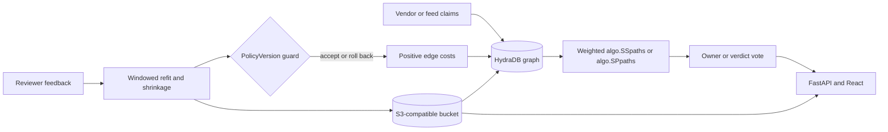

# DreamGraph

MIT-licensed source. The benchmark input datasets retain their own provenance and terms in [`data/README.md`](data/README.md).

**Your scanner says vulnerable. Your distro says patched. Who is right?** Dependabot, Snyk, Trivy, and Grype can raise an NVD-based alert for a package version that Debian, Red Hat, SUSE, or Alpine says is already fixed or was never affected. Security teams lose hours reconciling the feeds. If they start dismissing the noise, a real vulnerability can slip through.

DreamGraph learns **which feed to trust for each project** from reviewed outcomes. It stores positive trust costs on claim edges in HydraDB, then uses weighted path search to answer “is this version affected?” with an auditable route through the feeds and their costs. A guard rejects a proposed update when it would perform worse on held-back reviews, limiting the damage from a wrong or poisoned mirror. This is a [HydraDB hackathon](https://luma.com/bqwllms4) Track 1 submission.

**Proof.** Against hand-labeled affected tags from [Zenodo 16440960](https://zenodo.org/records/16440960) and real OSV feeds, DreamGraph reaches **68.2% held-out accuracy (95% CI 66.8–69.6)** on **1,317 checks across 3 seeds**, up from **57.1%**. NVD alone scores **64.9%** and majority vote **59.5%**. With poisoned feedback, an unguarded learner falls to **35.0%** while DreamGraph holds **65.1%**. The full baselines, limitations, and provenance are below. The gold set covers 1,128 CVEs.

**Who pays.** SCA and scanner vendors need a feed-trust API. Platform and security teams need a way to prioritize alerts with evidence. A weekly public feed-trust leaderboard and a free GitHub Action that annotates scanner alerts are proposed distribution paths.

## Use it

The live API checks tags in the bundled Zenodo slice using HydraDB's weighted `algo.SPpaths` vote. The public host may need to wake up. OpenAPI is at [the live API docs](https://dreamgraph.onrender.com/docs). Unknown tags return HTTP 404; malformed fields return HTTP 422. `POST /api/verdict` accepts one object or a list of 1–20 objects; `POST /api/verdict/batch` accepts the same list.

```bash
curl -G 'https://dreamgraph.onrender.com/api/verdict' \
  --data-urlencode 'cve=CVE-2022-4304' \
  --data-urlencode 'package=openssl' \
  --data-urlencode 'version=OpenSSL_1_1_1t'
```

An abridged response has this shape (the live path costs and vote share are calculated on request):

```json
{
  "cve": "CVE-2022-4304",
  "package": "openssl",
  "version": "OpenSSL_1_1_1t",
  "verdict": "not_affected",
  "trust_paths": [
    {"feed": "nvd", "claim": "not_affected", "in_vote": true},
    {"feed": "debian", "claim": "affected", "in_vote": false}
  ],
  "gold_label": "not_affected",
  "engine": "hydradb-live",
  "procedure": "algo.SPpaths"
}
```

`confidence` is the winning share of `exp(-path cost)` votes among the top five paths within 0.15 of the cheapest, not a calibrated probability. Here four of five feeds say affected, but the learned trust path picks the one that matches the reviewed label. The example above is abridged (costs omitted): actual responses include all returned trust paths and `confidence_note`. PolicyVersion 7 is the policy scored in the published final iteration; the subsequent fit produced version 8 after that scoring pass.

For Claude Code, put this in `.mcp.json`; for Cursor, put the same `mcpServers` entry in `.cursor/mcp.json` (Cursor can omit `type`):

```json
{"mcpServers":{"dreamgraph":{"type":"http","url":"https://dreamgraph.onrender.com/mcp"}}}
```

The MCP tool is `check_vulnerability(cve, package, version)`. For a local stdio client, use `python -m dreamgraph.mcp` as the command after installing `requirements.txt`; it calls the local API at `http://127.0.0.1:8000` by default. Set `DG_VERDICT_API_URL` to override it.

## Roadmap

- GitHub Action to annotate Dependabot and Trivy alerts with the API's trust verdict and feed evidence.
- Weekly public feed-trust leaderboard.

## What the run actually did

The numbers below are copied from [`results/summary.json`](results/summary.json) and the evidence files next to it (`results/public_summary.json`, `results/poison.json`, `results/one_hop.json`, `results/hypotheses.json`). They are not typed in by hand. `python -m dreamgraph.evidence` rebuilds the book slice, the 1-hop replay, the poison scenario, and the PASS/FAIL lines. `DG_BACKEND=hydradb python -m dreamgraph.bench` is what produced the synthetic HydraDB series; the evidence step does not overwrite those accuracies.

There are two datasets. The ownership gadgets are **synthetic**: each company has a 3-hop chain that names the true owner 90% of the time, a 2-hop trap that is right 20% of the time, and another 2-hop chain that is right 45% of the time. The second set is real vulnerability intel: Zenodo 16440960 gold tags, scored against NVD ranges and OSV distro feeds. There is no live corporate registry in this repo.

The chart is a **precomputed export**. The benchmark wrote the document through moto and copied that object to `results/summary.json`. The query box does not read a stored answer. It calls `algo.SSpaths` on the running node.

**Backend of this file: `hydradb`.** `results/probe.json` has `"live_engine": true`. DreamGraph, the unweighted walk, hand-set costs, the one-shot fit, greedy, and the frozen model all took their held-out answers from weighted or unweighted `algo.SSpaths` against `ghcr.io/hydra-db/hydradb:0.4.0` running natively on moto (Docker was not installed; `CLOUD_PROVIDER=local` rejects updates). The dict learner is the ablation: the same refit and the same sum, on plain dicts, with no engine round trip.

Held-out accuracy, percent, 300 questions, seeds 0, 1, and 2. Iteration 4 is the label swap, scored **before** that iteration's update. `hop3` is the share of answers whose chosen path has 3 edges.

| Method | 1 | 2 | 3 | 4 | 5 | 6 | 7 | 8 | hop3 at 8 |
|---|---:|---:|---:|---:|---:|---:|---:|---:|---:|
| DreamGraph | 20.7 | 90.6 | 90.6 | 45.9 | 90.6 | 90.6 | 90.6 | 90.6 | 1.00 |
| Dict learner | 20.7 | 90.6 | 90.6 | 45.9 | 90.6 | 90.6 | 90.6 | 90.6 | 1.00 |
| Unweighted | 20.7 | 20.7 | 20.7 | 20.7 | 20.7 | 20.7 | 20.7 | 20.7 | 0.00 |
| Hand-set costs | 90.6 | 90.6 | 90.6 | 45.9 | 45.9 | 45.9 | 45.9 | 45.9 | 0.00 |
| One-shot fit | 20.7 | 90.6 | 90.6 | 45.9 | 45.9 | 45.9 | 45.9 | 45.9 | 0.00 |
| Greedy online | 20.7 | 90.6 | 90.6 | 45.9 | 60.7 | 76.3 | 74.9 | 61.6 | 0.33 |
| BM25 labels | 90.6 | 90.6 | 90.6 | 57.0 | 57.0 | 57.0 | 57.0 | 57.0 | 0.00 |
| Frozen after 3 | 20.7 | 90.6 | 90.6 | 45.9 | 45.9 | 45.9 | 45.9 | 45.9 | 0.00 |

DreamGraph's iteration-8 mean is 90.6%, stratified bootstrap 95% interval **88.4–92.4**. At the drift score the interval is **42.6–49.0** around 45.9. Every recovered DreamGraph answer is the 3-hop chain: the sum of three learned edge costs beat both 2-hop chains. Unweighted search, which only counts hops, stays at 20.7% and its 3-hop rate stays 0. That is the composition result.

The dict learner **matches DreamGraph's accuracies on every iteration**. Same objective, different place the sum runs. HydraDB's weighted path search is what consumes the learned costs on the published synthetic run. The learner is not a second path algorithm hiding in the engine. Greedy, with decay and no window, ends at 61.6% and a 3-hop rate of 0.33. Hand-set costs, the one-shot fit, and the model frozen after iteration 3 stay at 45.9% after the swap and stop taking the long chain. BM25 stays at 57.0%. This drift run's guard did not roll a refit back. The poison scenario below is the run where it does.

### Ablations

Same learned costs, four ways of spending them. Final iteration, synthetic ownership, three seeds. The 1-hop series is a memory replay of the same update loop; its DreamGraph column matches the HydraDB series on every iteration (`results/one_hop.json`, max absolute difference 0).

| Arm | What it does | Final accuracy | 3-hop rate |
|---|---|---:|---:|
| 1-hop lookup | learned cost of the first edge only, no `algo.SSpaths` | 45.9 | 0.00 |
| Unweighted | path search, every edge weight 1 | 20.7 | 0.00 |
| DreamGraph | learned costs summed by HydraDB `algo.SSpaths` | 90.6 | 1.00 |
| Dict learner | the same sum, outside the engine | 90.6 | 1.00 |

1-hop final 95% interval **42.6–48.9**. With uniform costs the 1-hop node-id tie-break happens to select the long chain, so it starts at 90.6 while the full sum, which counts hops, starts at 20.7. After the labels move, summing the whole path is what recovers. The 1-hop lookup stays on the short chain at 45.9. The dict learner matches because it computes that same path-cost sum in process. The contribution is the learned edge cost that HydraDB's weighted search consumes, not a private objective.

### Vulnerability feeds

Question: is upstream tag V of project P affected by CVE-X? Gold is Zenodo record 16440960 (CC BY 4.0), the manual affected-tag lists. A tag that appears for that repository in the gold file and is not in the CVE's affected list is not-affected. Feeds are NVD CPE ranges from the CVE-to-OSV conversion, plus OSV dumps for Debian, Alpine, Red Hat, Linux, AlmaLinux, openSUSE, SUSE, Mageia, and Rocky Linux. The processed slice is `data/vuln/claims.jsonl` (1,817 questions, 500 train / 1,317 held out per seed). Regenerate with `python scripts/fetch_vuln.py`. See `data/README.md`.

Drift is **real**. Questions are ordered by the newest feed `modified` time. From the older half of the slice to the newer half, NVD's accuracy rises by 0.10 and SUSE's falls by 0.10 (also Mageia −0.09, openSUSE −0.07, Rocky −0.08). No simulated label swap is applied on this run. Each feed is a two-edge chain, question → claim → verdict. Costs are a feed×project shrinkage toward the feed cost (strength 8). The headline vote keeps the five cheapest verdict paths and drops any path more than 0.15 above the cheapest, then weights the rest by `exp(-cost)`. Held-out accuracy, percent:

| Method | 1 | 2 | 3 | 4 | 5 | 6 | 7 | 8 |
|---|---:|---:|---:|---:|---:|---:|---:|---:|
| DreamGraph | 57.1 | 61.1 | 61.1 | 61.4 | 65.0 | 64.7 | 65.4 | 68.2 |
| Dict learner | 57.1 | 61.1 | 61.1 | 61.4 | 65.0 | 64.7 | 65.4 | 68.2 |
| Conditional, k=1 | 52.1 | 61.1 | 61.1 | 61.4 | 65.4 | 65.0 | 65.1 | 67.9 |
| Top-5, no margin | 57.1 | 60.4 | 60.4 | 60.3 | 62.2 | 62.3 | 63.5 | 65.8 |
| Per-feed cost | 52.1 | 60.6 | 60.6 | 60.6 | 64.2 | 64.4 | 64.3 | 63.3 |
| NVD only | 64.9 | 64.9 | 64.9 | 64.9 | 64.9 | 64.9 | 64.9 | 64.9 |
| Hand-set costs | 65.0 | 65.0 | 65.0 | 65.0 | 65.0 | 65.0 | 65.0 | 65.0 |
| BM25 labels | 64.5 | 64.5 | 64.5 | 64.5 | 64.5 | 64.5 | 64.5 | 64.5 |
| Greedy online | 52.1 | 62.8 | 56.0 | 61.8 | 62.2 | 58.8 | 64.7 | 64.6 |
| 1-hop lookup | 64.1 | 60.5 | 60.5 | 60.5 | 64.2 | 64.4 | 64.3 | 63.3 |
| Unweighted | 52.1 | 52.1 | 52.1 | 52.1 | 52.1 | 52.1 | 52.1 | 52.1 |
| Frozen after 3 | 57.1 | 61.1 | 61.1 | 61.4 | 61.4 | 61.4 | 61.4 | 61.4 |
| One-shot fit | 57.1 | 61.1 | 61.1 | 61.1 | 61.1 | 61.1 | 61.1 | 61.1 |
| Majority vote | 59.5 | 59.5 | 59.5 | 59.5 | 59.5 | 59.5 | 59.5 | 59.5 |
| GHSA only | 50.8 | 50.8 | 50.8 | 50.8 | 50.8 | 50.8 | 50.8 | 50.8 |

DreamGraph's final mean is 68.2%, interval **66.8–69.6**. NVD alone is 64.9% (interval 63.5–66.4). The intervals do not overlap. Majority vote is 59.5% (interval 58.0–60.9). The same conditional costs with only the cheapest path finish at 67.9%. An unrestricted top-5 vote finishes at 65.8%. Per-feed costs, ignoring the project, finish at 63.3%, below NVD. GHSA is 50.8% because the Advisory API returned these CVEs with no version ranges, so that baseline abstains and is scored as not-affected. The curve is that vote over the two-hop chains. A single `algo.SSpaths` budget of 5 is filled by the cheaper one-hop edges, so the live query calls `algo.SPpaths` once per verdict with `pathCount` and `resultLimit` both 5 and votes the paths that come back.

Learned cost against measured accuracy on the slice (lower cost means more trust). The Linux OSV feed is perfect on 74 judgments and is not a broad voter.

| Feed | Learned cost | Accuracy | n |
|---|---:|---:|---:|
| linux | 0.082 | 100.0 | 74 |
| nvd | 0.481 | 65.6 | 1745 |
| alpine | 0.624 | 67.9 | 1195 |
| debian | 0.789 | 57.8 | 1716 |
| suse | 0.859 | 54.1 | 1537 |
| opensuse | 0.880 | 55.7 | 1642 |
| mageia | 1.141 | 55.0 | 863 |
| redhat | 1.262 | 51.0 | 784 |
| alma | 1.325 | 49.4 | 622 |
| rocky | 1.666 | 46.4 | 569 |
| nvd_mirror | 2.203 | 34.4 | 1745 |

`nvd_mirror` is a modeled aggregator that publishes the opposite of NVD's verdict. It is not a downloaded feed. Spearman correlation of learned cost with error rate is 0.96.

### NVD mirror, and the guard

From iteration 4, new training reviews treat NVD as always wrong and `nvd_mirror` as always right. Reviews already logged stay as written, and a proposal that gets worse on that pre-poison prefix is rolled back. Held-out edges stay as built. 13 rollbacks: 4 on seed 0, 5 on seed 1, and 4 on seed 2. DreamGraph stays at 65.1% (interval 63.7–66.5), the same number as the model frozen after iteration 3. Naive, with no guard, ends at 35.0% (interval 33.3–36.4). Hypothesis H12, threshold unchanged, is **PASS**: the frozen gap is 0. H16 is **PASS**: seed 2 rolls back too.

### Poison, and the guard that fires

From iteration 4, train reviews treat `wikidata` as always wrong and `scraper` as always right. Held-out people do not move, and there is no label swap in this scenario. A naive refit of the whole window accepts the lie. The guard fits on `window[:-20]` and scores both policies on the last 20 against the true owner. 15 rollbacks: 5 per seed, iterations 4 through 8. One receipt, seed 0 iteration 4: guard accuracy 60% → 40%, held-out 91.7% → 44.7%, reason `guard accuracy fell`, proposed costs all strictly positive, policy kept.

| Method | 1 | 2 | 3 | 4 | 5 | 6 | 7 | 8 |
|---|---:|---:|---:|---:|---:|---:|---:|---:|
| DreamGraph | 20.7 | 76.3 | 90.6 | 90.6 | 90.6 | 90.6 | 90.6 | 90.6 |
| Dict learner | 20.7 | 76.3 | 90.6 | 90.6 | 90.6 | 90.6 | 90.6 | 90.6 |
| Frozen after 3 | 20.7 | 76.3 | 90.6 | 90.6 | 90.6 | 90.6 | 90.6 | 90.6 |
| Naive, no guard | 20.7 | 90.6 | 90.6 | 90.6 | 45.9 | 45.9 | 45.9 | 45.9 |
| Greedy online | 20.7 | 68.0 | 90.6 | 75.8 | 45.9 | 45.9 | 45.9 | 45.9 |
| 1-hop lookup | 90.6 | 61.6 | 61.6 | 75.8 | 75.8 | 75.8 | 75.8 | 75.8 |
| Unweighted | 20.7 | 20.7 | 20.7 | 20.7 | 20.7 | 20.7 | 20.7 | 20.7 |

DreamGraph's final interval is **88.7–92.4**. Naive ends at 45.9% (interval 42.7–49.1). The frozen model also ends on DreamGraph's number, because the poison starts at iteration 4 and a model that stopped at iteration 3 never ingests it. The receipt log is the evidence the guard looked. Hypothesis H9 records that tie on purpose.

### Hypotheses

Pre-registered in `dreamgraph/hypotheses.py`. `results/hypotheses.json` is the evaluator's output.

| Id | Verdict | Observed |
|---|---|---|
| H1 | PASS | Synthetic full path beats 1-hop by 0.4467 at iteration 8 |
| H2 | PASS | Published 3-hop rate beats unweighted by 1.00 |
| H3 | PASS | Dict learner matches published DreamGraph, max abs diff 0 |
| H4 | PASS | Vuln Spearman of cost vs error 0.9636 |
| H5 | PASS | Vuln dict learner matches DreamGraph, max abs diff 0 |
| H6 | PASS | Vuln DreamGraph exceeds majority by 0.0871 |
| H7 | PASS | Synthetic poison: 15 rollbacks, naive 0.4467 below DreamGraph |
| H8 | PASS | All 15 synthetic receipts are well-formed |
| H9 | PASS | Frozen-after-3 ties DreamGraph on the synthetic poison run |
| H10 | PASS | NVD-mirror poison: 13 rollbacks, naive 0.3009 below DreamGraph |
| H11 | PASS | All 13 vulnerability receipts are well-formed |
| H12 | PASS | Frozen-after-3 ties DreamGraph on the NVD-mirror run |
| H13 | PASS | Conditional top-5 vote exceeds NVD-only by 0.0326 |
| H14 | PASS | Margin vote exceeds unrestricted top-5 by 0.0240 |
| H15 | PASS | Conditional k=1 exceeds per-feed k=1 by 0.0458 |
| H16 | PASS | Every poison seed rolls back, including seed 2 |

Concurrent load, 20 clients, 30 weighted `algo.SSpaths` calls each (n = 600): p50 **6.33 ms**, p95 **12.56 ms**, p99 **15.88 ms**. Those are engine round trips.

## Engineering

### Reproduce the evaluation

Use Python 3.12, Node 22, and a running HydraDB `0.4.0` node backed by an S3-compatible bucket. First run `make probe` and check `results/probe.json` for `"live_engine": true`; then:

```bash
make install
make lint test web
make reproduce
```

`make reproduce` requires the live node at `DG_HYDRA_URL` and **refuses an in-process fallback**. It runs the synthetic HydraDB benchmark, replays the one-hop and Book controls, runs both poison scenarios and the vulnerability slice, evaluates H1–H16, and regenerates the `results/*.json` evaluation exports. It checks that the independent synthetic replay matches HydraDB and that every pre-registered check passes before replacing exports. It writes the benchmark summary through moto, then exports `results/summary.json`. The generated timestamp will change; accuracy numbers are deterministic for the committed data and defaults. The vulnerability benchmark uses committed `data/vuln/claims.jsonl`, so it does not require live NVD or OSV downloads. CI runs lint, pytest, and the frontend build without a HydraDB service; the path vote test uses a fake transport.

### Architecture



The synthetic ownership world has competing chains from one company to candidate people, with no cross edge or shortcut stage. The vulnerability world has one two-edge claim chain per feed and verdict. Reviewer feedback refits strictly positive source costs; vulnerability costs also shrink each feed×project estimate toward its feed cost. `PolicyVersion` records the guard score and any rollback. The learner stamps `cost` on graph edges; HydraDB's `weightProp: 'cost'` makes `algo.SSpaths` or `algo.SPpaths` minimize the sum. Live vulnerability queries call `algo.SPpaths` per verdict and vote returned paths. Synthetic held-out paths use `algo.SSpaths`. Every path call sets equal positive `pathCount` and `resultLimit` total caps and every request gets a new UUID `query_id`.

At iteration 4, `seed.py --drift` swaps the `wikidata` and `scraper` labels on relations 15 and up. Endpoints stay put. Held-out ids start at 1000, so the whole held-out set swaps. The learner then sees the new labels only through the trailing window of 100 train questions. It never writes a gold edge cost of 0.

HydraDB, when you run it, stores the graph in the bucket. The query node's disk is cache. Local disk is not the source of truth. See `docs/HYDRA_RUNBOOK.md`.

### Results and ablations

The tables above are copied from the JSON exports. On **1,317 held-out vulnerability tags per seed, across three seeds**, DreamGraph ends at **68.2% (95% CI 66.8–69.6)**; NVD-only is **64.9% (63.5–66.4)**. The same learner over plain dicts ties DreamGraph at 68.2%. Per-feed costs without project conditioning reach 63.3%; unrestricted top-five voting reaches 65.8%; the one-shot fit reaches 61.1%. Under poisoned training feedback, the guard keeps 65.1% (63.7–66.5), while the naive unguarded fit falls to 35.0% (33.3–36.4). The frozen-after-3 model ties the guarded model in that poison test. The synthetic ownership ablation gives 90.6% for HydraDB weighted search and the dict twin, 45.9% for a one-hop lookup, and 20.7% unweighted. [H1–H16 and their observed verdicts](#hypotheses) were declared in code before evaluation.

### What broke

- The Book dataset tied all baselines at **96.7%**. It did not distinguish learning or path search, so the vulnerability slice became the main real-data evaluation. Book results remain as an ablation in the exports.
- A `cell-0` writer lease made seeding fail after a node restart. The seeding path now retries with backoff while the lease clears.
- three.js r181 removed `Object3D.intersectsFrustum`, which crashed the 3D graph when a second Three copy was bundled. The graph includes a compatibility shim and the Vite build deduplicates Three.

### Limits

The vulnerability benchmark replays a cached slice rather than querying current feeds, and `nvd_mirror` is a modeled adversarial source. Its main evaluation uses an in-process graph; the live `algo.SPpaths` path is confirmed on a sample and exposed in the query API. The dict learner ties DreamGraph, so the evidence supports HydraDB as the weighted search engine, not an accuracy gain over an equivalent Python Dijkstra. The poison guard ties a frozen model, so it shows resistance to that attack, not learning through it. The synthetic vendor noise is generated, and the public app is a demonstration rather than a multi-tenant service.

## Run it locally

Python 3.12 and Node 22.

```bash
python3 -m venv .venv
. .venv/bin/activate
pip install -r requirements.txt
make test
make bench          # rewrites results/summary.json; series match the table above
cd web && npm install && npm run build && cd ..
make serve          # http://127.0.0.1:8000
```

`make probe` runs the live checks. Without Docker it starts the extracted `graph-node` against moto (`scripts/run_hydradb_native.sh`). `CLOUD_PROVIDER=local` is not usable for this workload: the local object store rejects `PutMode::Update`. With Docker:

```bash
python scripts/probe_hydradb.py
docker compose --profile engine up
```

`DG_BACKEND=hydradb make bench` is how `results/summary.json` was produced. It refuses to start unless `results/probe.json` has `"live_engine": true` and `http://127.0.0.1:8443/healthz` answers. It does not fall back to the in-process graph.

The dashboard:

- Accuracy chart with the eight lines, bootstrap bands, and a drift marker at iteration 4.
- A company picker and an Unweighted / DreamGraph toggle. The path is computed on the request. Several demo companies are marked where the two modes disagree.
- Policy versions, with rollbacks listed first.
- p50 / p95 / p99, plus Measure again for a live in-process sample.

## Deploy to Render

`render.yaml` is a Blueprint for one Docker web service. The image builds from a fresh clone: the Node stage builds the dashboard, then the runtime copies `graph-node` and `libgraphblas` out of `ghcr.io/hydra-db/hydradb:0.4.0`. Nothing in the build uses a locally unpacked layer. On boot the container starts moto, HydraDB, and FastAPI. FastAPI binds `0.0.0.0:$PORT`. `/healthz` returns 200 only after HydraDB's own `/healthz` does. The demo world is seeded in the background (`DG_SEED_ON_BOOT=1`). The dashboard pill reads `/api/health` and shows **Live engine**, **Seeding HydraDB**, or **Engine down**.

One container is enough for the demo seed. On this machine, after a fresh start, `graph-node` was about 100 MB RSS and moto about 180 MB, before the seed. The published chart is the precomputed export baked into the image. The query box is the part that needs the live node.

```bash
# After the GitHub repo exists and is connected in Render:
# Dashboard → New → Blueprint → pick this repo.
```

| | |
|---|---|
| Plan in the Blueprint | `starter` (`0.5c-512mb`, 0.5 CPU, 512 MB). `free` is 0.1 CPU and the same RAM, and is more likely to be killed while seeding. |
| If the deploy is OOM-killed | Set `plan: 1c-2g` (1 CPU, 2 GB) in `render.yaml` and sync the Blueprint. |
| Env vars | `PORT` is injected by Render. Do not set it. `HYDRADB_AUTH_TOKEN` is `generateValue: true` (a random bearer shared by the app and `graph-node`). `DG_SEED_ON_BOOT=1`. No AWS account keys. moto's `testing` / `testing` pair is created inside the container. |
| Health check | `GET /healthz` on the public port. |
| Cold start | About 30–90 seconds until `/healthz` is 200 (image start, moto, graph-node). The query box stays on "Seeding HydraDB" for another minute or two while the demo world is written. The chart is available as soon as the page loads. Free instances also sleep after 15 minutes of no traffic; the next visit pays the cold start again, and the world is reseeded because moto is memory-only unless a disk is mounted. |
| Optional disk | Not in `render.yaml`, and the plan is unchanged. A paid instance can mount a disk at `/var/lib/dreamgraph` and set `DG_STATE_DIR=/var/lib/dreamgraph/state`. `container_boot.sh` restores that directory into moto before `graph-node` starts and snapshots the bucket every two minutes. An empty directory, which is the free plan, restores nothing. |
| Region | `oregon` in the Blueprint. Change it before the first sync if the workspace uses another region. |

A second service is not required. Split only if a 2 GB instance still cannot keep `graph-node` and moto in one box: a private service for the engine on 8443, and this web service with `DG_HYDRA_URL=http://<engine-host>:8443`. They would need a shared token and the engine would still need its own moto or a bucket. That split is not in `render.yaml`.

## Railway

Nothing in this repo was deployed.

1. Create a Railway project and a bucket.
2. Add a service from the image `ghcr.io/hydra-db/hydradb:0.4.0`. Check the pulled digest against `results/probe.json` (`digest.index_digest` and `digest.platforms["linux/amd64"]`). Public port **8443**, health `/healthz`. Variables: `deploy/hydradb.env.example`. The start command has to write `GRAPH_AUTH_TOKEN` to a file because the image reads `GRAPH_AUTH_TOKEN_FILE`. Cache at `/var/cache/slatedb` is disposable.
3. Add the app from this Dockerfile (`railway.toml`). It listens on `0.0.0.0:$PORT` and the health check is `/api/health`. Default `PORT` in the image is 8000. The committed results file is baked in, so the chart works before HydraDB is wired up. Label stays "HydraDB unverified" until you re-probe and replace the export.
4. Do not put both processes on 8000.

## Image digest recorded from GHCR

Not from a local `docker image inspect`. Re-check after a pull.

| | |
|---|---|
| Tag | `ghcr.io/hydra-db/hydradb:0.4.0` |
| Index | `sha256:ab71d651fefee13ebb23eb56d72316065bdca563ff7587442e07be663f2bf880` |
| linux/amd64 | `sha256:e837db24b4c11eba759001aa6143bd7415a4fe811045831f83b6b03eec8a4bb5` |
| linux/arm64 | `sha256:64fa5979c940f7b97fa8fdac8131e4adbeec84687dac0686a8342248953ea782` |

## Limitations

- The world is disjoint competing chains, not a shared corporate registry. People are not reused across companies.
- Source noise is a fixed coin flip per chain, not a scrape.
- The dict learner ties DreamGraph because both minimize the same edge-cost sum. HydraDB is what evaluated that sum for every DreamGraph answer in the synthetic file. The tie is the measurement. Unweighted search, which does not, never selects the 3-hop chain. The 1-hop lookup, which spends only the first edge, finishes at 45.9% after recovery.
- On the vulnerability slice DreamGraph finishes at 68.2%, above NVD-only (64.9%) and majority (59.5%). The DreamGraph and NVD intervals do not overlap. Per-feed costs finish at 63.3%, below NVD. Learned feed costs still rank with measured error (Spearman 0.96).
- The NVD-mirror guard rolls back 13 times, including seed 2. H12 is PASS: the frozen model ties DreamGraph. The synthetic poison guard still rolls back 15 times.
- `pathCount` is still sized as a total cap. On a single source the probe's `pathCount: 2` returned 2 rows. That does not separate a per-pair reading from a total cap. The client sets `resultLimit` to the same total anyway.
- Greedy only partly recovers on the label swap. The window is what puts the 3-hop rate back to 1.00. The drift run's guard did not fire. The poison run rolls back 15 times.
- Latency will move if you re-time it. The accuracy series will not, for these seeds.
- No authentication, no multi-tenant graph, no production bucket was created.

## Layout

`AGENTS.md` and `PHASES.md` are the build rules. `docs/HYDRA_RUNBOOK.md` is the engine. `docs/LOOM_SCRIPT.md` is a three-minute walkthrough. `docs/POSTS.md` is two drafts. Neither the loom nor the posts were published.
