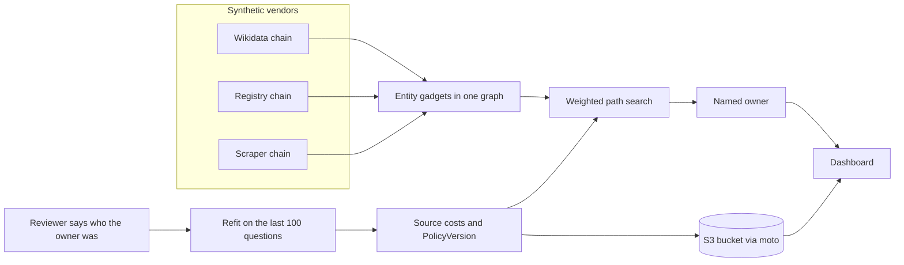

# DreamGraph

DreamGraph picks a beneficial-owner path through a multi-vendor entity graph, then refits the cost of each vendor when reviewers confirm or reject the person that path named. It is a [HydraDB hackathon](https://luma.com/bqwllms4) Track 1 submission: a graph that gets sharper every run, and has to earn its place against a store that does not know which vendor just went bad.

**Who pays.** Compliance and data teams merging KYC or B2B enrichment from more than one vendor. A company record arrives from Wikidata, a registry, and a scraper, and the three disagree about the owner. The team pays when an analyst or a filing follows the wrong chain. They pay again when a vendor relabels a feed and a model frozen last quarter keeps trusting the old name.

## What the run actually did

The numbers below are copied from [`results/summary.json`](results/summary.json) and the evidence files next to it (`results/public_summary.json`, `results/poison.json`, `results/one_hop.json`, `results/hypotheses.json`). They are not typed in by hand. `python -m dreamgraph.evidence` rebuilds the book slice, the 1-hop replay, the poison scenario, and the PASS/FAIL lines. `DG_BACKEND=hydradb python -m dreamgraph.bench` is what produced the synthetic HydraDB series; the evidence step does not overwrite those accuracies.

There are two datasets. The ownership gadgets are **synthetic**: each company has a 3-hop chain that names the true owner 90% of the time, a 2-hop trap that is right 20% of the time, and another 2-hop chain that is right 45% of the time. The second set is real: three booksellers listing the same ISBNs, scored against the 100-book gold author lists. There is no live corporate registry in this repo.

The chart is a **precomputed export**. The benchmark wrote the document through moto and copied that object to `results/summary.json`. The query box does not read a stored answer. It calls `algo.SSpaths` on the running node.

**Backend of this file: `hydradb`.** `results/probe.json` has `"live_engine": true`. DreamGraph, the unweighted walk, hand-set costs, the one-shot fit, greedy, and the frozen model all took their held-out answers from weighted or unweighted `algo.SSpaths` against `ghcr.io/hydra-db/hydradb:0.4.0` running natively on moto (Docker was not installed; `CLOUD_PROVIDER=local` rejects updates). The dict learner is the ablation: the same refit and the same sum, on plain dicts, with no engine round trip.

Held-out accuracy, percent, 300 questions, seeds 0, 1, and 2. Iteration 4 is the label swap, scored **before** that iteration's update. `hop3` is the share of answers whose chosen path has 3 edges.

| Method | 1 | 2 | 3 | 4 | 5 | 6 | 7 | 8 | hop3 at 8 |
|---|---:|---:|---:|---:|---:|---:|---:|---:|---:|
| DreamGraph | 20.7 | 90.6 | 90.6 | 45.9 | 90.6 | 90.6 | 90.6 | 90.6 | 1.00 |
| Dict learner | 20.7 | 90.6 | 90.6 | 45.9 | 90.6 | 90.6 | 90.6 | 90.6 | 1.00 |
| Unweighted | 20.7 | 20.7 | 20.7 | 20.7 | 20.7 | 20.7 | 20.7 | 20.7 | 0.00 |
| Hand-set costs | 90.6 | 90.6 | 90.6 | 45.9 | 45.9 | 45.9 | 45.9 | 45.9 | 0.00 |
| One-shot fit | 20.7 | 90.6 | 90.6 | 45.9 | 45.9 | 45.9 | 45.9 | 45.9 | 0.00 |
| Greedy online | 20.7 | 90.6 | 90.6 | 45.9 | 60.7 | 76.3 | 74.9 | 61.6 | 0.33 |
| BM25 labels | 90.6 | 90.6 | 90.6 | 57.0 | 57.0 | 57.0 | 57.0 | 57.0 | 0.00 |
| Frozen after 3 | 20.7 | 90.6 | 90.6 | 45.9 | 45.9 | 45.9 | 45.9 | 45.9 | 0.00 |

DreamGraph's iteration-8 mean is 90.6%, stratified bootstrap 95% interval **88.4–92.4**. At the drift score the interval is **42.6–49.0** around 45.9. Every recovered DreamGraph answer is the 3-hop chain: the sum of three learned edge costs beat both 2-hop chains. Unweighted search, which only counts hops, stays at 20.7% and its 3-hop rate stays 0. That is the composition result.

The dict learner **matches DreamGraph's accuracies on every iteration**. Same objective, different place the sum runs. HydraDB's weighted path search is what consumes the learned costs on the published synthetic run. The learner is not a second path algorithm hiding in the engine. Greedy, with decay and no window, ends at 61.6% and a 3-hop rate of 0.33. Hand-set costs, the one-shot fit, and the model frozen after iteration 3 stay at 45.9% after the swap and stop taking the long chain. BM25 stays at 57.0%. This drift run's guard did not roll a refit back. The poison scenario below is the run where it does.

### Ablations

Same learned costs, four ways of spending them. Final iteration, synthetic ownership, three seeds. The 1-hop series is a memory replay of the same update loop; its DreamGraph column matches the HydraDB series on every iteration (`results/one_hop.json`, max absolute difference 0).

| Arm | What it does | Final accuracy | 3-hop rate |
|---|---|---:|---:|
| 1-hop lookup | learned cost of the first edge only, no `algo.SSpaths` | 45.9 | 0.00 |
| Unweighted | path search, every edge weight 1 | 20.7 | 0.00 |
| DreamGraph | learned costs summed by HydraDB `algo.SSpaths` | 90.6 | 1.00 |
| Dict learner | the same sum, outside the engine | 90.6 | 1.00 |

1-hop final 95% interval **42.6–48.9**. With uniform costs the 1-hop node-id tie-break happens to select the long chain, so it starts at 90.6 while the full sum, which counts hops, starts at 20.7. After the labels move, summing the whole path is what recovers. The 1-hop lookup stays on the short chain at 45.9. The dict learner matches because it computes that same path-cost sum in process. The contribution is the learned edge cost that HydraDB's weighted search consumes, not a private objective.

### Book sellers

Public slice of the Book data set (Yin, Han, and Yu, TKDE 2008, claims; Dong, Berti-Equille, and Srivastava, VLDB 2009, gold author lists from book covers). Cached at `data/book/claims.jsonl`. Checksums and the regenerate command are in `data/book/PROVENANCE.md`. Three sellers with at least two listings on a gold ISBN: **Revaluation Books**, **The Book Depository**, **textbooksNow**. 55 books. Each seed holds out 30 and trains on 25, resampled with the same window (100), guard (20), batch (40), and 8 iterations. Bootstrap 95% intervals, seeds 0, 1, and 2.

Descriptive accuracy on the full slice, not used as a feature: Revaluation Books 96.4% (53/55), The Book Depository 62.5% (25/40), textbooksNow 38.1% (8/21). A claim matches gold when token Jaccard is at least 0.5.

Each seller is a 2-edge chain, book → listing → author. Both edges carry that seller's cost, and the length does not depend on being right. Held-out accuracy, percent:

| Method | 1 | 2 | 3 | 4 | 5 | 6 | 7 | 8 |
|---|---:|---:|---:|---:|---:|---:|---:|---:|
| DreamGraph | 96.7 | 96.7 | 96.7 | 96.7 | 96.7 | 96.7 | 96.7 | 96.7 |
| Dict learner | 96.7 | 96.7 | 96.7 | 96.7 | 96.7 | 96.7 | 96.7 | 96.7 |
| 1-hop lookup | 96.7 | 96.7 | 96.7 | 96.7 | 96.7 | 96.7 | 96.7 | 96.7 |
| Unweighted | 96.7 | 96.7 | 96.7 | 96.7 | 96.7 | 96.7 | 96.7 | 96.7 |
| Hand-set costs | 96.7 | 96.7 | 96.7 | 96.7 | 96.7 | 96.7 | 96.7 | 96.7 |
| One-shot fit | 96.7 | 96.7 | 96.7 | 96.7 | 96.7 | 96.7 | 96.7 | 96.7 |
| Greedy online | 96.7 | 96.7 | 96.7 | 96.7 | 96.7 | 96.7 | 96.7 | 96.7 |
| Frozen after 3 | 96.7 | 96.7 | 96.7 | 96.7 | 96.7 | 96.7 | 96.7 | 96.7 |
| BM25 labels | 78.9 | 78.9 | 78.9 | 78.9 | 78.9 | 78.9 | 78.9 | 78.9 |

DreamGraph's final mean is 96.7%, interval **92.2–100.0**. It ties unweighted, the 1-hop lookup, the dict learner, the hand-set volume prior, greedy, and the frozen model. Listing node ids follow alphabetical seller order, so an unweighted tie-break already selects Revaluation Books whenever that seller listed the book, and Revaluation listed every book in the slice. The learned costs still recover the ranking: mean final cost 0.041 for Revaluation Books, 0.839 for The Book Depository, 1.545 for textbooksNow. Seed 2 swaps the middle two (textbooksNow 0.600, The Book Depository 0.671) and still keeps Revaluation cheapest. BM25, whose query tokens do not name any of these sellers, tie-breaks on author-node id and finishes at 78.9% (interval 71.1–86.7). These book accuracies are the in-process sum. The live query box runs the same costs through `algo.SSpaths`.

### Poison, and the guard that fires

From iteration 4, train reviews treat `wikidata` as always wrong and `scraper` as always right. Held-out people do not move, and there is no label swap in this scenario. A naive refit of the whole window accepts the lie. The guard fits on `window[:-20]` and scores both policies on the last 20 against the true owner. 15 rollbacks: 5 per seed, iterations 4 through 8. One receipt, seed 0 iteration 4: guard accuracy 60% → 40%, held-out 91.7% → 44.7%, reason `guard accuracy fell`, proposed costs all strictly positive, policy kept.

| Method | 1 | 2 | 3 | 4 | 5 | 6 | 7 | 8 |
|---|---:|---:|---:|---:|---:|---:|---:|---:|
| DreamGraph | 20.7 | 76.3 | 90.6 | 90.6 | 90.6 | 90.6 | 90.6 | 90.6 |
| Dict learner | 20.7 | 76.3 | 90.6 | 90.6 | 90.6 | 90.6 | 90.6 | 90.6 |
| Frozen after 3 | 20.7 | 76.3 | 90.6 | 90.6 | 90.6 | 90.6 | 90.6 | 90.6 |
| Naive, no guard | 20.7 | 90.6 | 90.6 | 90.6 | 45.9 | 45.9 | 45.9 | 45.9 |
| Greedy online | 20.7 | 68.0 | 90.6 | 75.8 | 45.9 | 45.9 | 45.9 | 45.9 |
| 1-hop lookup | 90.6 | 61.6 | 61.6 | 75.8 | 75.8 | 75.8 | 75.8 | 75.8 |
| Unweighted | 20.7 | 20.7 | 20.7 | 20.7 | 20.7 | 20.7 | 20.7 | 20.7 |

DreamGraph's final interval is **88.7–92.4**. Naive ends at 45.9% (interval 42.7–49.1). The frozen model also ends on DreamGraph's number, because the poison starts at iteration 4 and a model that stopped at iteration 3 never ingests it. The receipt log is the evidence the guard looked. Hypothesis H9 records that tie on purpose.

### Hypotheses

Pre-registered in `dreamgraph/hypotheses.py`. `results/hypotheses.json` is the evaluator's output.

| Id | Verdict | Observed |
|---|---|---|
| H1 | PASS | Synthetic full path beats 1-hop by 0.4467 at iteration 8 |
| H2 | PASS | Published 3-hop rate beats unweighted by 1.00 |
| H3 | PASS | Dict learner matches published DreamGraph, max abs diff 0 |
| H4 | PASS | Book costs: Revaluation Books 0.041 vs textbooksNow 1.545 |
| H5 | PASS | Book dict learner matches DreamGraph, max abs diff 0 |
| H6 | PASS | Book final accuracy 0.9667 |
| H7 | PASS | 15 rollbacks, and naive finishes 0.4467 below DreamGraph |
| H8 | PASS | All 15 receipts are well-formed |
| H9 | PASS | Frozen-after-3 ties DreamGraph on the poison run |

Concurrent load, 20 clients, 30 weighted `algo.SSpaths` calls each (n = 600): p50 **6.33 ms**, p95 **12.56 ms**, p99 **15.88 ms**. Those are engine round trips.

## Architecture



Each relation is three two-hop chains from one company to a person, with no cross edge and no shortcut stage. Search picks the minimum-cost path that ends on a person. A weighted call is the `algo.SSpaths` shape in `dreamgraph/hydra_client.py` (`weightProp: 'cost'`, `pathCount` and `resultLimit` set to the same total). This run used the in-process implementation of that choice.

At iteration 4, `seed.py --drift` swaps the `wikidata` and `scraper` labels on relations 15 and up. Endpoints stay put. Held-out ids start at 1000, so the whole held-out set swaps. The learner then sees the new labels only through the trailing window of 100 train questions. It never writes a gold edge cost of 0.

HydraDB, when you run it, stores the graph in the bucket. The query node's disk is cache. Local disk is not the source of truth. See `docs/HYDRA_RUNBOOK.md`.

## Run it locally

Python 3.12 and Node 22.

```bash
python3 -m venv .venv
. .venv/bin/activate
pip install -r requirements.txt
make test
make bench          # rewrites results/summary.json; series match the table above
cd web && npm install && npm run build && cd ..
make serve          # http://127.0.0.1:8000
```

`make probe` runs the live checks. Without Docker it starts the extracted `graph-node` against moto (`scripts/run_hydradb_native.sh`). `CLOUD_PROVIDER=local` is not usable for this workload: the local object store rejects `PutMode::Update`. With Docker:

```bash
python scripts/probe_hydradb.py
docker compose --profile engine up
```

`DG_BACKEND=hydradb make bench` is how `results/summary.json` was produced. It refuses to start unless `results/probe.json` has `"live_engine": true` and `http://127.0.0.1:8443/healthz` answers. It does not fall back to the in-process graph.

The dashboard:

- Accuracy chart with the eight lines, bootstrap bands, and a drift marker at iteration 4.
- A company picker and an Unweighted / DreamGraph toggle. The path is computed on the request. Several demo companies are marked where the two modes disagree.
- Policy versions, with rollbacks listed first.
- p50 / p95 / p99, plus Measure again for a live in-process sample.

## Deploy to Render

`render.yaml` is a Blueprint for one Docker web service. The image builds from a fresh clone: the Node stage builds the dashboard, then the runtime copies `graph-node` and `libgraphblas` out of `ghcr.io/hydra-db/hydradb:0.4.0`. Nothing in the build uses a locally unpacked layer. On boot the container starts moto, HydraDB, and FastAPI. FastAPI binds `0.0.0.0:$PORT`. `/healthz` returns 200 only after HydraDB's own `/healthz` does. The demo world is seeded in the background (`DG_SEED_ON_BOOT=1`). The dashboard pill reads `/api/health` and shows **Live engine**, **Seeding HydraDB**, or **Engine down**.

One container is enough for the demo seed. On this machine, after a fresh start, `graph-node` was about 100 MB RSS and moto about 180 MB, before the seed. The published chart is the precomputed export baked into the image. The query box is the part that needs the live node.

```bash
# After the GitHub repo exists and is connected in Render:
# Dashboard → New → Blueprint → pick this repo.
```

| | |
|---|---|
| Plan in the Blueprint | `starter` (`0.5c-512mb`, 0.5 CPU, 512 MB). `free` is 0.1 CPU and the same RAM, and is more likely to be killed while seeding. |
| If the deploy is OOM-killed | Set `plan: 1c-2g` (1 CPU, 2 GB) in `render.yaml` and sync the Blueprint. |
| Env vars | `PORT` is injected by Render. Do not set it. `HYDRADB_AUTH_TOKEN` is `generateValue: true` (a random bearer shared by the app and `graph-node`). `DG_SEED_ON_BOOT=1`. No AWS account keys. moto's `testing` / `testing` pair is created inside the container. |
| Health check | `GET /healthz` on the public port. |
| Cold start | About 30–90 seconds until `/healthz` is 200 (image start, moto, graph-node). The query box stays on "Seeding HydraDB" for another minute or two while the demo world is written. The chart is available as soon as the page loads. Free instances also sleep after 15 minutes of no traffic; the next visit pays the cold start again, and the world is reseeded because moto is memory-only unless a disk is mounted. |
| Optional disk | Not in `render.yaml`, and the plan is unchanged. A paid instance can mount a disk at `/var/lib/dreamgraph` and set `DG_STATE_DIR=/var/lib/dreamgraph/state`. `container_boot.sh` restores that directory into moto before `graph-node` starts and snapshots the bucket every two minutes. An empty directory, which is the free plan, restores nothing. |
| Region | `oregon` in the Blueprint. Change it before the first sync if the workspace uses another region. |

A second service is not required. Split only if a 2 GB instance still cannot keep `graph-node` and moto in one box: a private service for the engine on 8443, and this web service with `DG_HYDRA_URL=http://<engine-host>:8443`. They would need a shared token and the engine would still need its own moto or a bucket. That split is not in `render.yaml`.

## Railway

Nothing in this repo was deployed.

1. Create a Railway project and a bucket.
2. Add a service from the image `ghcr.io/hydra-db/hydradb:0.4.0`. Check the pulled digest against `results/probe.json` (`digest.index_digest` and `digest.platforms["linux/amd64"]`). Public port **8443**, health `/healthz`. Variables: `deploy/hydradb.env.example`. The start command has to write `GRAPH_AUTH_TOKEN` to a file because the image reads `GRAPH_AUTH_TOKEN_FILE`. Cache at `/var/cache/slatedb` is disposable.
3. Add the app from this Dockerfile (`railway.toml`). It listens on `0.0.0.0:$PORT` and the health check is `/api/health`. Default `PORT` in the image is 8000. The committed results file is baked in, so the chart works before HydraDB is wired up. Label stays "HydraDB unverified" until you re-probe and replace the export.
4. Do not put both processes on 8000.

## Image digest recorded from GHCR

Not from a local `docker image inspect`. Re-check after a pull.

| | |
|---|---|
| Tag | `ghcr.io/hydra-db/hydradb:0.4.0` |
| Index | `sha256:ab71d651fefee13ebb23eb56d72316065bdca563ff7587442e07be663f2bf880` |
| linux/amd64 | `sha256:e837db24b4c11eba759001aa6143bd7415a4fe811045831f83b6b03eec8a4bb5` |
| linux/arm64 | `sha256:64fa5979c940f7b97fa8fdac8131e4adbeec84687dac0686a8342248953ea782` |

## Limitations

- The world is disjoint competing chains, not a shared corporate registry. People are not reused across companies.
- Source noise is a fixed coin flip per chain, not a scrape.
- The dict learner ties DreamGraph because both minimize the same edge-cost sum. HydraDB is what evaluated that sum for every DreamGraph answer in the synthetic file. The tie is the measurement. Unweighted search, which does not, never selects the 3-hop chain. The 1-hop lookup, which spends only the first edge, finishes at 45.9% after recovery.
- On the Book slice the unweighted tie-break already selects the best seller, so learned costs do not raise accuracy. They do rank Revaluation Books below textbooksNow. Seed 2 swaps the middle two sellers.
- The poison guard fires 15 times. A model frozen before the poison also survives. H9 says so.
- `pathCount` is still sized as a total cap. On a single source the probe's `pathCount: 2` returned 2 rows. That does not separate a per-pair reading from a total cap. The client sets `resultLimit` to the same total anyway.
- Greedy only partly recovers on the label swap. The window is what puts the 3-hop rate back to 1.00. The drift run's guard did not fire. The poison run rolls back 15 times.
- Latency will move if you re-time it. The accuracy series will not, for these seeds.
- No authentication, no multi-tenant graph, no production bucket was created.

## Layout

`AGENTS.md` and `PHASES.md` are the build rules. `docs/HYDRA_RUNBOOK.md` is the engine. `docs/LOOM_SCRIPT.md` is a three-minute walkthrough. `docs/POSTS.md` is two drafts. Neither the loom nor the posts were published.
