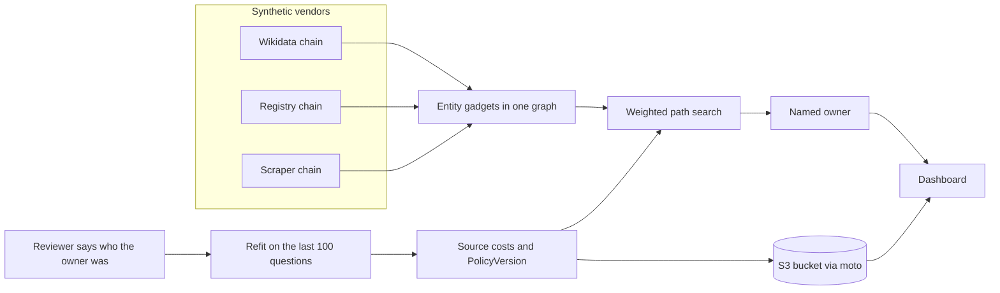

# DreamGraph

DreamGraph picks a beneficial-owner path through a multi-vendor entity graph, then refits the cost of each vendor when reviewers confirm or reject the person that path named. It is a [HydraDB hackathon](https://luma.com/bqwllms4) Track 1 submission: a graph that gets sharper every run, and has to earn its place against a store that does not know which vendor just went bad.

**Who pays.** Compliance and data teams merging KYC or B2B enrichment from more than one vendor. A company record arrives from Wikidata, a registry, and a scraper, and the three disagree about the owner. The team pays when an analyst or a filing follows the wrong chain. They pay again when a vendor relabels a feed and a model frozen last quarter keeps trusting the old name.

## What the run actually did

The numbers below are copied from [`results/summary.json`](results/summary.json), produced by `python -m dreamgraph.bench`. They are not typed in by hand. The noise model is **synthetic**: before any swap, a wikidata chain names the true owner with probability 0.88, registry 0.72, scraper 0.30. There is no live corporate registry in this repo.

The chart is a **precomputed export**. The benchmark wrote the document to an in-process S3 bucket (moto) and exported that object to `results/summary.json`. The query box does not read a stored answer; it walks the regenerated world on the request.

**Backend of this file: `memory`.** Dijkstra ran in-process. `results/probe.json` has `"live_engine": false` because this machine had no Docker, so `algo.SSpaths` / `algo.SPpaths` were **not** executed against `ghcr.io/hydra-db/hydradb:0.4.0`. The client, the Cypher, and the probe script are in the repo. They are not a substitute for a green probe.

Held-out accuracy, percent, 300 questions, seeds 0, 1, and 2. Iteration 4 is the label swap, scored **before** that iteration's update.

| Method | 1 | 2 | 3 | 4 | 5 | 6 | 7 | 8 |
|---|---:|---:|---:|---:|---:|---:|---:|---:|
| DreamGraph | 63.0 | 85.0 | 80.4 | 47.0 | 76.4 | 80.4 | 80.4 | 80.4 |
| Dict learner | 63.0 | 85.0 | 80.4 | 47.0 | 76.4 | 80.4 | 80.4 | 80.4 |
| Unweighted | 63.0 | 63.0 | 63.0 | 63.0 | 63.0 | 63.0 | 63.0 | 63.0 |
| Hand-set costs | 85.0 | 85.0 | 85.0 | 33.8 | 33.8 | 33.8 | 33.8 | 33.8 |
| One-shot fit | 63.0 | 85.0 | 85.0 | 33.8 | 33.8 | 33.8 | 33.8 | 33.8 |
| Greedy online | 63.0 | 80.4 | 81.4 | 33.8 | 72.9 | 80.4 | 80.4 | 81.4 |
| BM25 labels | 85.0 | 85.0 | 85.0 | 33.8 | 33.8 | 33.8 | 33.8 | 33.8 |
| Frozen after 3 | 63.0 | 85.0 | 80.4 | 47.0 | 47.0 | 47.0 | 47.0 | 47.0 |

DreamGraph's iteration-8 mean is 80.4%, stratified bootstrap 95% interval **77.7–82.9**. At the drift score the interval is **44.0–50.0** around 47.0. Frozen after iteration 3 stays at 47.0. Hand-set costs, BM25, and the one-shot fit fall to 33.8 and stay there, because they still prefer the label `wikidata` after that label has been moved onto the noisy chains.

The dict learner is the same refit over `list[dict]` edges and its own Dijkstra. It **matches DreamGraph on every iteration**. That is the measurement. HydraDB is the path engine, not a second learning rule, and this run did not ask the engine to search.

Greedy online updates (decay 0.85, no window, no guard) also recover, on a slightly different path. With this source gap, a short memory is enough. The window still matters for the guard: seed 2 rolled a refit back at iterations 4 and 5 because the guard slice got worse, then accepted a later refit. Those two `PolicyVersion` rows are in the JSON with `"rolled_back": true`. Seeds 0 and 1 did not roll back.

Unweighted search is flat at 63.0%. Drift swaps labels, not endpoints, and the tie break is the path's node ids, so the unweighted choice does not move.

In-process search latency on seed 0, n = 2400: p50 6.5 µs, p95 8.0 µs, p99 9.5 µs (`load` in the JSON, milliseconds × 1000). That is not a HydraDB round trip. Do not quote it as one.

## Architecture



Each relation is three two-hop chains from one company to a person, with no cross edge and no shortcut stage. Search picks the minimum-cost path that ends on a person. A weighted call is the `algo.SSpaths` shape in `dreamgraph/hydra_client.py` (`weightProp: 'cost'`, `pathCount` and `resultLimit` set to the same total). This run used the in-process implementation of that choice.

At iteration 4, `seed.py --drift` swaps the `wikidata` and `scraper` labels on relations 15 and up. Endpoints stay put. Held-out ids start at 1000, so the whole held-out set swaps. The learner then sees the new labels only through the trailing window of 100 train questions. It never writes a gold edge cost of 0.

HydraDB, when you run it, stores the graph in the bucket. The query node's disk is cache. Local disk is not the source of truth. See `docs/HYDRA_RUNBOOK.md`.

## Run it locally

Python 3.12 and Node 22.

```bash
python3 -m venv .venv
. .venv/bin/activate
pip install -r requirements.txt
make test
make bench          # rewrites results/summary.json; series match the table above
cd web && npm install && npm run build && cd ..
make serve          # http://127.0.0.1:8000
```

`make probe` records the registry digest and, without Docker, exits 2. That exit is not a pass. With Docker:

```bash
python scripts/probe_hydradb.py
docker compose --profile engine up
```

`DG_BACKEND=hydradb make bench` refuses to run unless `results/probe.json` has `"live_engine": true`, and even then it stops rather than pretend the in-process numbers were served by HydraDB. Wiring every held-out query through HTTP is left as a follow-up once the probe is green. Do not flip the JSON's `backend` field by hand.

The dashboard:

- Accuracy chart with the eight lines, bootstrap bands, and a drift marker at iteration 4.
- A company picker and an Unweighted / DreamGraph toggle. The path is computed on the request. Several demo companies are marked where the two modes disagree.
- Policy versions, with rollbacks listed first.
- p50 / p95 / p99, plus Measure again for a live in-process sample.

## Railway

Nothing in this repo was deployed.

1. Create a Railway project and a bucket.
2. Add a service from the image `ghcr.io/hydra-db/hydradb:0.4.0`. Check the pulled digest against `results/probe.json` (`digest.index_digest` and `digest.platforms["linux/amd64"]`). Public port **8443**, health `/healthz`. Variables: `deploy/hydradb.env.example`. The start command has to write `GRAPH_AUTH_TOKEN` to a file because the image reads `GRAPH_AUTH_TOKEN_FILE`. Cache at `/var/cache/slatedb` is disposable.
3. Add the app from this Dockerfile (`railway.toml`). It listens on `0.0.0.0:$PORT` and the health check is `/api/health`. Default `PORT` in the image is 8000. The committed results file is baked in, so the chart works before HydraDB is wired up. Label stays "HydraDB unverified" until you re-probe and replace the export.
4. Do not put both processes on 8000.

## Image digest recorded from GHCR

Not from a local `docker image inspect`. Re-check after a pull.

| | |
|---|---|
| Tag | `ghcr.io/hydra-db/hydradb:0.4.0` |
| Index | `sha256:ab71d651fefee13ebb23eb56d72316065bdca563ff7587442e07be663f2bf880` |
| linux/amd64 | `sha256:e837db24b4c11eba759001aa6143bd7415a4fe811045831f83b6b03eec8a4bb5` |
| linux/arm64 | `sha256:64fa5979c940f7b97fa8fdac8131e4adbeec84687dac0686a8342248953ea782` |

## Limitations

- The world is a pile of disjoint two-hop gadgets. A real ownership graph has shared people, cycles, and edges the generator did not intend. Those are not in this measurement.
- Source noise is a fixed coin flip, not a scrape.
- The dict learner tying DreamGraph means the update rule does not need HydraDB. The engine still has to be the thing that walks the weighted path before this is a HydraDB result. That walk was not run here.
- `pathCount` is treated as a total cap because TrailMend measured it that way. Upstream docs still say it is per pair. The live probe is the check, and it did not run.
- Greedy recovers too. The window and the guard are not the only story on a gap this wide; the guard's real effect in this run is the two seed-2 rollbacks, which delay that seed.
- Latency figures are in-process. They will move a little if you re-time them. Accuracy will not, for these seeds.
- No authentication, no multi-tenant graph, no production bucket was created.

## Layout

`AGENTS.md` and `PHASES.md` are the build rules. `docs/HYDRA_RUNBOOK.md` is the engine. `docs/LOOM_SCRIPT.md` is a three-minute walkthrough. `docs/POSTS.md` is two drafts. Neither the loom nor the posts were published.
