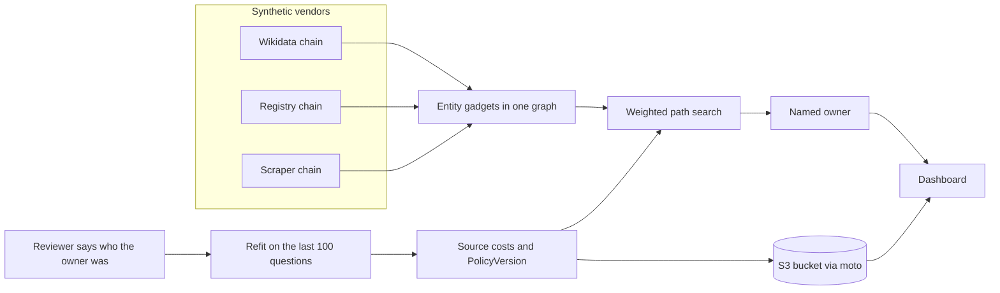

# DreamGraph

DreamGraph picks a beneficial-owner path through a multi-vendor entity graph, then refits the cost of each vendor when reviewers confirm or reject the person that path named. It is a [HydraDB hackathon](https://luma.com/bqwllms4) Track 1 submission: a graph that gets sharper every run, and has to earn its place against a store that does not know which vendor just went bad.

**Who pays.** Compliance and data teams merging KYC or B2B enrichment from more than one vendor. A company record arrives from Wikidata, a registry, and a scraper, and the three disagree about the owner. The team pays when an analyst or a filing follows the wrong chain. They pay again when a vendor relabels a feed and a model frozen last quarter keeps trusting the old name.

## What the run actually did

The numbers below are copied from [`results/summary.json`](results/summary.json), produced by `DG_BACKEND=hydradb python -m dreamgraph.bench`. They are not typed in by hand. The noise model is **synthetic**: each company has a 3-hop chain that names the true owner 90% of the time, a 2-hop trap that is right 20% of the time, and another 2-hop chain that is right 45% of the time. There is no live corporate registry in this repo.

The chart is a **precomputed export**. The benchmark wrote the document through moto and copied that object to `results/summary.json`. The query box does not read a stored answer. It calls `algo.SSpaths` on the running node.

**Backend of this file: `hydradb`.** `results/probe.json` has `"live_engine": true`. DreamGraph, the unweighted walk, hand-set costs, the one-shot fit, greedy, and the frozen model all took their held-out answers from weighted or unweighted `algo.SSpaths` against `ghcr.io/hydra-db/hydradb:0.4.0` running natively on moto (Docker was not installed; `CLOUD_PROVIDER=local` rejects updates). The dict learner is the ablation: the same refit and the same sum, on plain dicts, with no engine round trip.

Held-out accuracy, percent, 300 questions, seeds 0, 1, and 2. Iteration 4 is the label swap, scored **before** that iteration's update. `hop3` is the share of answers whose chosen path has 3 edges.

| Method | 1 | 2 | 3 | 4 | 5 | 6 | 7 | 8 | hop3 at 8 |
|---|---:|---:|---:|---:|---:|---:|---:|---:|---:|
| DreamGraph | 20.7 | 90.6 | 90.6 | 45.9 | 90.6 | 90.6 | 90.6 | 90.6 | 1.00 |
| Dict learner | 20.7 | 90.6 | 90.6 | 45.9 | 90.6 | 90.6 | 90.6 | 90.6 | 1.00 |
| Unweighted | 20.7 | 20.7 | 20.7 | 20.7 | 20.7 | 20.7 | 20.7 | 20.7 | 0.00 |
| Hand-set costs | 90.6 | 90.6 | 90.6 | 45.9 | 45.9 | 45.9 | 45.9 | 45.9 | 0.00 |
| One-shot fit | 20.7 | 90.6 | 90.6 | 45.9 | 45.9 | 45.9 | 45.9 | 45.9 | 0.00 |
| Greedy online | 20.7 | 90.6 | 90.6 | 45.9 | 60.7 | 76.3 | 74.9 | 61.6 | 0.33 |
| BM25 labels | 90.6 | 90.6 | 90.6 | 57.0 | 57.0 | 57.0 | 57.0 | 57.0 | 0.00 |
| Frozen after 3 | 20.7 | 90.6 | 90.6 | 45.9 | 45.9 | 45.9 | 45.9 | 45.9 | 0.00 |

DreamGraph's iteration-8 mean is 90.6%, stratified bootstrap 95% interval **88.4–92.4**. At the drift score the interval is **42.6–49.0** around 45.9. Every recovered DreamGraph answer is the 3-hop chain: the sum of three learned edge costs beat both 2-hop chains. Unweighted search, which only counts hops, stays at 20.7% and its 3-hop rate stays 0. That is the composition result.

The dict learner **matches DreamGraph's accuracies on every iteration**. Same objective, different place the sum runs. The gap that is not zero is latency, and the methods that do not recompute the full sum. Greedy, with decay and no window, ends at 61.6% and a 3-hop rate of 0.33. Hand-set costs, the one-shot fit, and the model frozen after iteration 3 stay at 45.9% after the swap and stop taking the long chain. BM25 stays at 57.0%. This run's guard did not roll a refit back.

Concurrent load, 20 clients, 30 weighted `algo.SSpaths` calls each (n = 600): p50 **6.33 ms**, p95 **12.56 ms**, p99 **15.88 ms**. Those are engine round trips.

## Architecture



Each relation is three two-hop chains from one company to a person, with no cross edge and no shortcut stage. Search picks the minimum-cost path that ends on a person. A weighted call is the `algo.SSpaths` shape in `dreamgraph/hydra_client.py` (`weightProp: 'cost'`, `pathCount` and `resultLimit` set to the same total). This run used the in-process implementation of that choice.

At iteration 4, `seed.py --drift` swaps the `wikidata` and `scraper` labels on relations 15 and up. Endpoints stay put. Held-out ids start at 1000, so the whole held-out set swaps. The learner then sees the new labels only through the trailing window of 100 train questions. It never writes a gold edge cost of 0.

HydraDB, when you run it, stores the graph in the bucket. The query node's disk is cache. Local disk is not the source of truth. See `docs/HYDRA_RUNBOOK.md`.

## Run it locally

Python 3.12 and Node 22.

```bash
python3 -m venv .venv
. .venv/bin/activate
pip install -r requirements.txt
make test
make bench          # rewrites results/summary.json; series match the table above
cd web && npm install && npm run build && cd ..
make serve          # http://127.0.0.1:8000
```

`make probe` runs the live checks. Without Docker it starts the extracted `graph-node` against moto (`scripts/run_hydradb_native.sh`). `CLOUD_PROVIDER=local` is not usable for this workload: the local object store rejects `PutMode::Update`. With Docker:

```bash
python scripts/probe_hydradb.py
docker compose --profile engine up
```

`DG_BACKEND=hydradb make bench` is how `results/summary.json` was produced. It refuses to start unless `results/probe.json` has `"live_engine": true` and `http://127.0.0.1:8443/healthz` answers. It does not fall back to the in-process graph.

The dashboard:

- Accuracy chart with the eight lines, bootstrap bands, and a drift marker at iteration 4.
- A company picker and an Unweighted / DreamGraph toggle. The path is computed on the request. Several demo companies are marked where the two modes disagree.
- Policy versions, with rollbacks listed first.
- p50 / p95 / p99, plus Measure again for a live in-process sample.

## Deploy to Render

`render.yaml` is a Blueprint for one Docker web service. The image builds from a fresh clone: the Node stage builds the dashboard, then the runtime copies `graph-node` and `libgraphblas` out of `ghcr.io/hydra-db/hydradb:0.4.0`. Nothing in the build uses a locally unpacked layer. On boot the container starts moto, HydraDB, and FastAPI. FastAPI binds `0.0.0.0:$PORT`. `/healthz` returns 200 only after HydraDB's own `/healthz` does. The demo world is seeded in the background (`DG_SEED_ON_BOOT=1`). The dashboard pill reads `/api/health` and shows **Live engine**, **Seeding HydraDB**, or **Engine down**.

One container is enough for the demo seed. On this machine, after a fresh start, `graph-node` was about 100 MB RSS and moto about 180 MB, before the seed. The published chart is the precomputed export baked into the image. The query box is the part that needs the live node.

```bash
# After the GitHub repo exists and is connected in Render:
# Dashboard → New → Blueprint → pick this repo.
```

| | |
|---|---|
| Plan in the Blueprint | `starter` (`0.5c-512mb`, 0.5 CPU, 512 MB). `free` is 0.1 CPU and the same RAM, and is more likely to be killed while seeding. |
| If the deploy is OOM-killed | Set `plan: 1c-2g` (1 CPU, 2 GB) in `render.yaml` and sync the Blueprint. |
| Env vars | `PORT` is injected by Render. Do not set it. `HYDRADB_AUTH_TOKEN` is `generateValue: true` (a random bearer shared by the app and `graph-node`). `DG_SEED_ON_BOOT=1`. No AWS account keys. moto's `testing` / `testing` pair is created inside the container. |
| Health check | `GET /healthz` on the public port. |
| Cold start | About 30–90 seconds until `/healthz` is 200 (image start, moto, graph-node). The query box stays on "Seeding HydraDB" for another minute or two while the demo world is written. The chart is available as soon as the page loads. Free instances also sleep after 15 minutes of no traffic; the next visit pays the cold start again, and the world is reseeded because moto is memory-only. |
| Region | `oregon` in the Blueprint. Change it before the first sync if the workspace uses another region. |

A second service is not required. Split only if a 2 GB instance still cannot keep `graph-node` and moto in one box: a private service for the engine on 8443, and this web service with `DG_HYDRA_URL=http://<engine-host>:8443`. They would need a shared token and the engine would still need its own moto or a bucket. That split is not in `render.yaml`.

## Railway

Nothing in this repo was deployed.

1. Create a Railway project and a bucket.
2. Add a service from the image `ghcr.io/hydra-db/hydradb:0.4.0`. Check the pulled digest against `results/probe.json` (`digest.index_digest` and `digest.platforms["linux/amd64"]`). Public port **8443**, health `/healthz`. Variables: `deploy/hydradb.env.example`. The start command has to write `GRAPH_AUTH_TOKEN` to a file because the image reads `GRAPH_AUTH_TOKEN_FILE`. Cache at `/var/cache/slatedb` is disposable.
3. Add the app from this Dockerfile (`railway.toml`). It listens on `0.0.0.0:$PORT` and the health check is `/api/health`. Default `PORT` in the image is 8000. The committed results file is baked in, so the chart works before HydraDB is wired up. Label stays "HydraDB unverified" until you re-probe and replace the export.
4. Do not put both processes on 8000.

## Image digest recorded from GHCR

Not from a local `docker image inspect`. Re-check after a pull.

| | |
|---|---|
| Tag | `ghcr.io/hydra-db/hydradb:0.4.0` |
| Index | `sha256:ab71d651fefee13ebb23eb56d72316065bdca563ff7587442e07be663f2bf880` |
| linux/amd64 | `sha256:e837db24b4c11eba759001aa6143bd7415a4fe811045831f83b6b03eec8a4bb5` |
| linux/arm64 | `sha256:64fa5979c940f7b97fa8fdac8131e4adbeec84687dac0686a8342248953ea782` |

## Limitations

- The world is disjoint competing chains, not a shared corporate registry. People are not reused across companies.
- Source noise is a fixed coin flip per chain, not a scrape.
- The dict learner ties DreamGraph because both minimize the same edge-cost sum. HydraDB is what evaluated that sum for every DreamGraph answer in this file. The tie is the measurement. Unweighted search, which does not, never selects the 3-hop chain.
- `pathCount` is still sized as a total cap. On a single source the probe's `pathCount: 2` returned 2 rows. That does not separate a per-pair reading from a total cap. The client sets `resultLimit` to the same total anyway.
- Greedy only partly recovers. The window is what puts the 3-hop rate back to 1.00. The guard did not fire on these three seeds.
- Latency will move if you re-time it. The accuracy series will not, for these seeds.
- No authentication, no multi-tenant graph, no production bucket was created.

## Layout

`AGENTS.md` and `PHASES.md` are the build rules. `docs/HYDRA_RUNBOOK.md` is the engine. `docs/LOOM_SCRIPT.md` is a three-minute walkthrough. `docs/POSTS.md` is two drafts. Neither the loom nor the posts were published.
